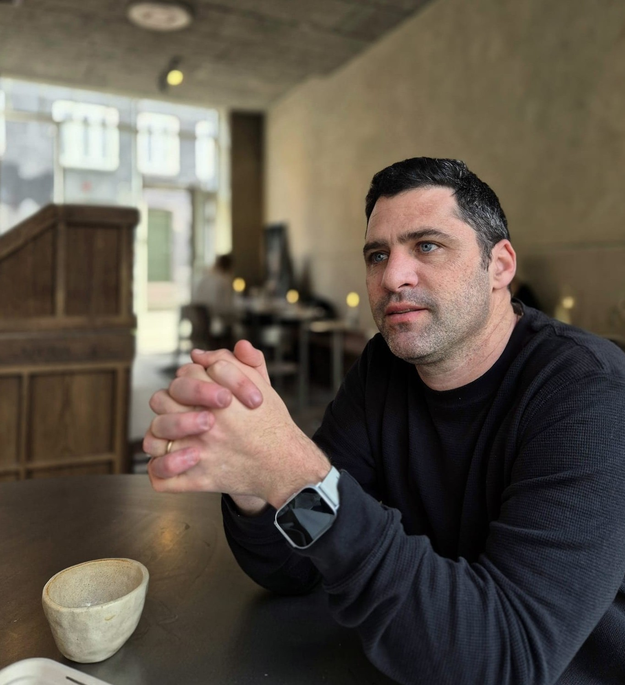

 
 

I am an academic researcher of public administration and political science. I am an assistant professor at [at the school of Political Sciences at the University of Haifa](https://poli.hevra.haifa.ac.il/index.php?option=com_sppagebuilder&view=page&id=3&Itemid=539&lang=en). 

My research focuses on the complex relations between bureaucracies, citizens, politicians, and technology and their implications for the functioning of democratic systems and governance, considering contemporary political and societal challenges. I am currently studying the implications of populist government on citizen-government relations.  

I am a methodological pluralist. I also employ in my studies a variety of additional empirical approaches, including experimental designs, observational analyses of administrative data, qualitative case studies, and quantitative and qualitative analyses of interviews. 

---

[`r #icon::fa("envelope")` E-mail: s.alon.barkat@poli.haifa.ac.il](mailto:s.alon.barkat@poli.haifa.ac.il)

[`r #icon::fa("bars")` Research Gate](https://www.researchgate.net/profile/Saar_Alon-Barkat)  

[`r #icon::fa("github")` saaralonbarkat (GitHub)](https://github.com/saaralonbarkat)

[`r #icon::fa("twitter")` saarbarkat](https://twitter.com/saarbarkat)

[`r #icon::fa("google")` Google Scholar](https://scholar.google.co.il/citations?user=KF2FL04AAAAJ&hl=en&oi=ao)

[`r #icon::fa("file-powerpoint")` Publons profile](https://publons.com/researcher/1367408/saar-alon-barkat/)

<a itemprop="sameAs" content="https://orcid.org/0000-0002-3342-0568" href="https://orcid.org/0000-0002-3342-0568" target="orcid.widget" rel="noopener noreferrer" style="vertical-align:top;">orcid.org/0000-0002-3342-0568</a>

---

